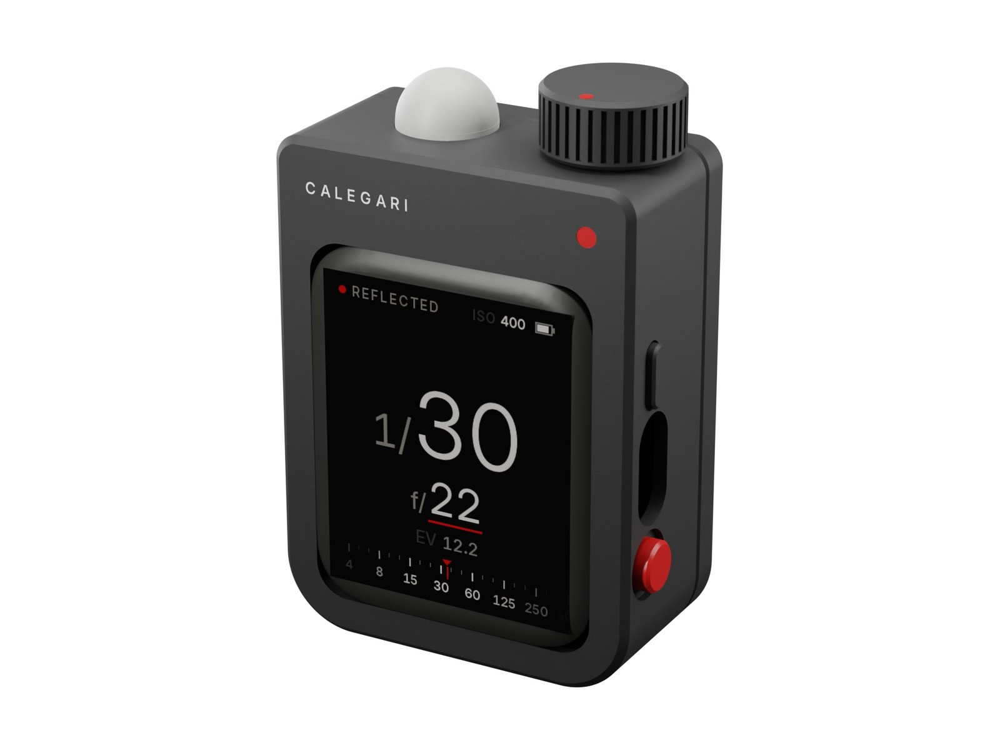
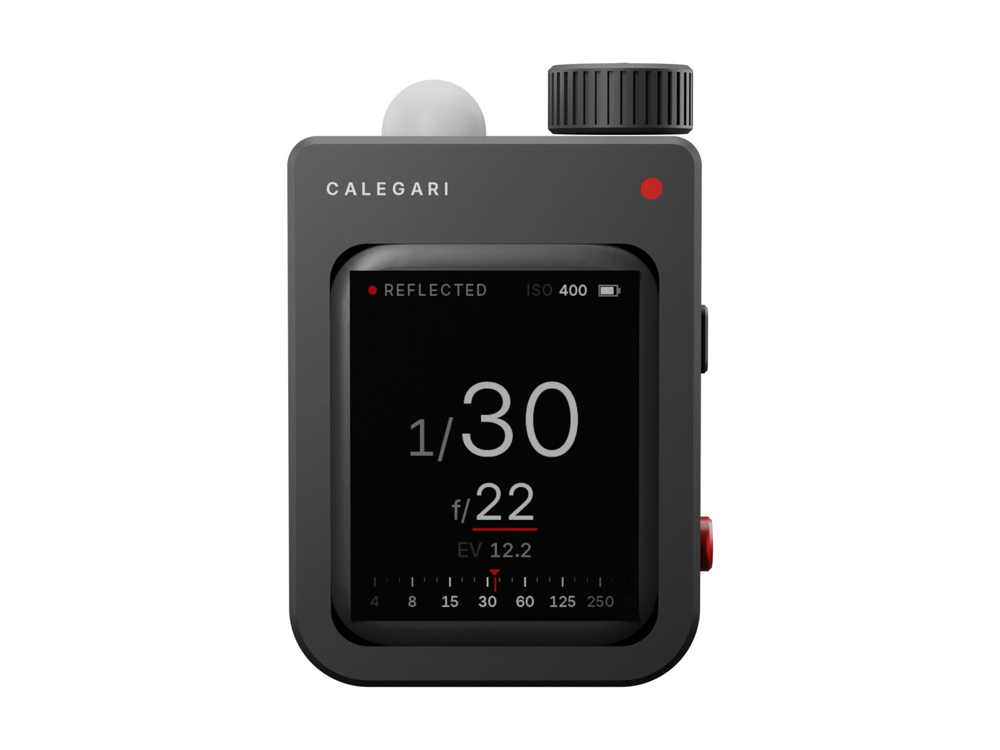
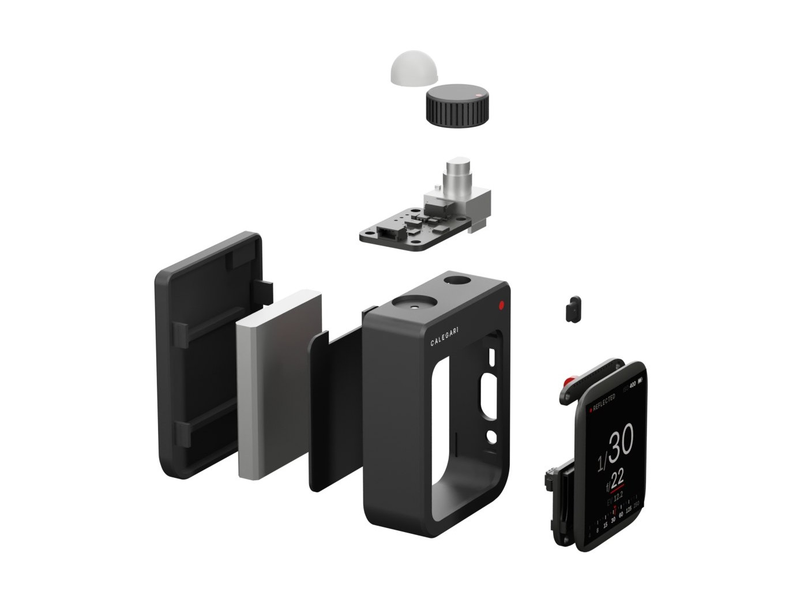

# Calegari Meter



A pocket light meter that you print at home, to go with the [Calegari View 2](https://github.com/achillecalegari/calegari-view-2). An AMOLED face, a translucent dome on top, a knurled dial and a red key on the side. It reads reflected and incident light, flash, colour temperature and the zone system, and it corrects long exposures for reciprocity failure.

**[Project page](https://achillecalegari.github.io/calegari-meter/)** · [Shopping list](docs/bom.md) · [Printing](docs/printing.md) · [Assembly](docs/assembly.md) · [Firmware](docs/firmware.md) · [Calibration](docs/calibration.md) · [Using the meter](docs/using.md) · [Design notes](docs/design.md)

## Why

A view camera wants a meter that is quick, quiet and exact, and that works with a lens in a Copal shutter: whole stops of time, thirds of aperture, long exposures on slow film, a flash now and then. The meters that do all of that are either big or expensive. This one is a small black block that sits in the hand like a first iPod shuffle. Its shape comes from the object, not from the board inside it.

## What it is

| | |
|---|---|
| Size | 41.6 x 55.7 x 21.4 mm, plus the dial (7 mm) and the dome (6 mm) on top |
| Screen | 1.8 inch AMOLED, 368 x 448, touch; black, warm white and one red |
| Light | reflected through a 44 degree cone; incident with the dome on. About EV -2 to 19 at ISO 100 (from the datasheet; the first meter will tell), the gain and integration time following the light |
| Answer | aperture priority or shutter priority; whole stops of time (as a Copal shutter is marked) or thirds; ISO 6 to 6400; compensation in thirds up to 3 stops |
| Film | reciprocity for HP5 Plus, FP4 Plus, Delta 100 and 400, Pan F Plus (Ilford's exponents), Tri-X 400 and Acros II (the makers' tables) |
| Flash | cordless: fire it, read the aperture for your sync speed, and how much of the exposure is flash |
| Colour | colour temperature and green or magenta tint from the sensor's eight channels; the Wratten filter that brings the light to daylight or tungsten film; flicker at 100 or 120 Hz |
| Zone | spot the shadows and the highlights: the range in stops, the N-development, the exposure that places the shadows in zone III |
| Power | a 500 mAh LiPo, charged over USB-C; it turns itself off |
| Build | seven printed parts, three bought boards, a battery, seven wires |



## How it works

| Part | What it does |
|---|---|
| Waveshare ESP32-S3-Touch-AMOLED-1.8 | the screen, its touch layer, the processor, the charger and the power key, the speaker, the USB-C. It is the face of the meter |
| Adafruit AS7341 | an eleven channel light sensor. It lies across the top, under a port whose rim is the stop for the 22 degree half angle of reflected light |
| The dome | translucent white PETG, pressed into a round seat over the port for incident light and colour. Off, it parks in the same seat under the foot |
| The LED window | a 1.4 mm hole over the sensor's own LED, under the dome's flange. The LED blinks when the light jumps: with the dome on, its light comes back through the flange; with the dome off, it leaves. That is how the meter knows which way it is reading |
| The dial | an EC11 encoder, its bushing threaded into the top wall, a knurled printed dial on its shaft |
| The red key | a printed cap that snaps through the side wall and presses the board's BOOT button |
| The power key | a printed pill that presses the board's power key |



## Checked before it is printed

- `cad/m2check.py`: every pair of parts, printed and bought. Designed contacts have a volume budget, everything else must not touch. **0 problems.**
- `cad/m2print.py`: every printed part as it lies on the bed: no supports, the overhangs above the first millimetre only where a bridge or a 45 degree chamfer carries them.
- `firmware`: builds with PlatformIO (`pio run`). The screens are drawn by the same code on a computer (`tools/host`): every image of the screen in these pages comes from it.

## Status

Designed, checked in CAD, firmware built and screens rendered. The first meter has not been put together yet. Two numbers in `firmware/src/config.h` come from the datasheets and must be confirmed on the first build: the lux per sensor count, which the light calibration then refines, and the threshold of the dome's detection. See [Calibration](docs/calibration.md).

## Build it

1. [Shopping list](docs/bom.md): about 60 EUR of parts.
2. [Printing](docs/printing.md): three plates, black, red and translucent white.
3. [Assembly](docs/assembly.md): seven wires, then everything presses or snaps in.
4. [Firmware](docs/firmware.md): one command over USB.
5. [Calibration](docs/calibration.md): the light against a meter you trust, the colour against a halogen bulb.

## Files

```
cad/            build123d model: m2params.py (every dimension), m2.py (the parts), m2check.py, m2print.py,
                m2export.py (STEP, STL, plates), m2render.py and m2stages.py (meshes for the pictures)
print/          step/, stl/ (oriented), plates/ (3MF, one per material)
firmware/       PlatformIO project for the Waveshare board
tools/          host/ (draws the screens on a computer), fontgen.py, colorgen.py, wiring.py
render/         Blender scripts for the white studio renders
docs/           the guides and the project page
```

## Licence

Hardware, documentation and firmware: [CC BY-NC-SA 4.0](LICENSE). The ES8311 codec driver in `firmware/lib/es8311` is Espressif's, under Apache 2.0. The screens use [Inter](https://rsms.me/inter/) by Rasmus Andersson, under the SIL Open Font License (`tools/fonts/OFL.txt`).
