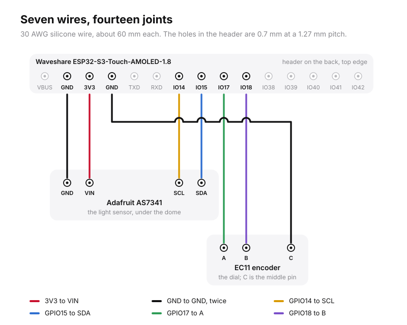
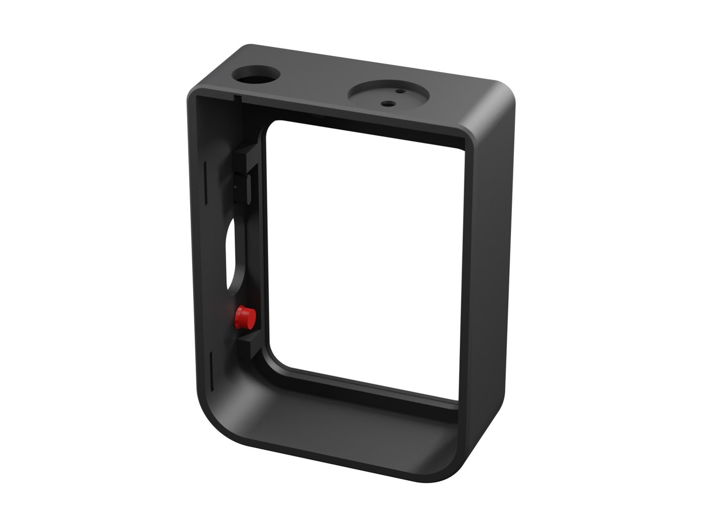
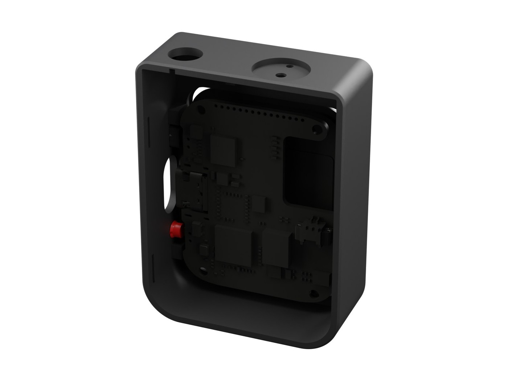
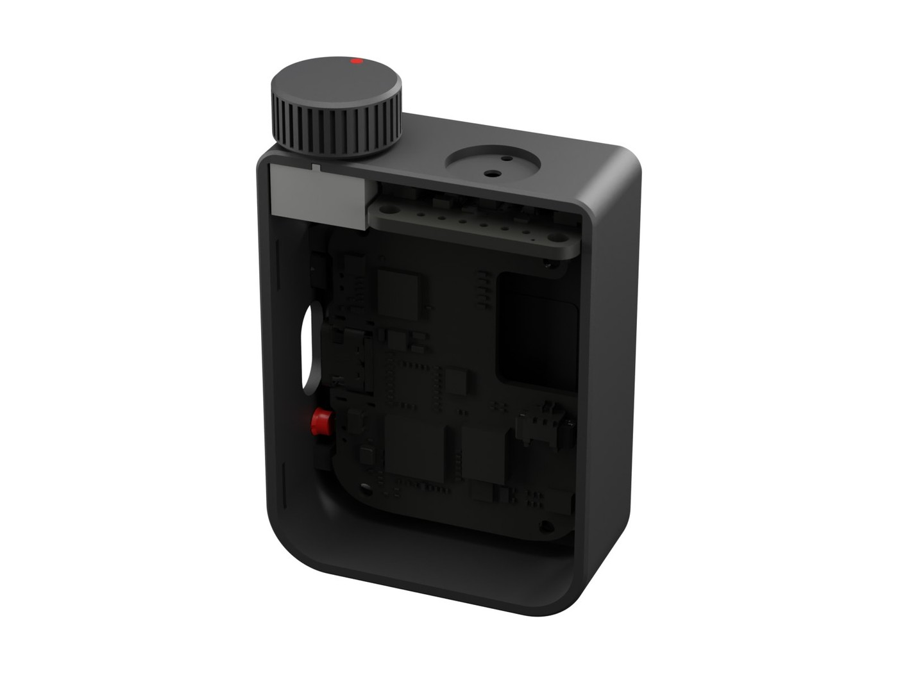
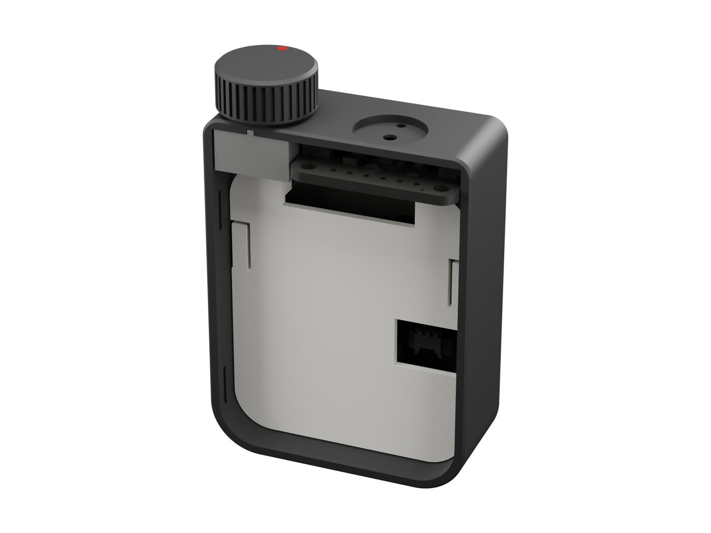
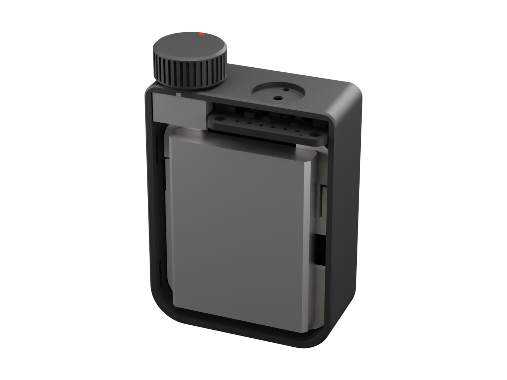
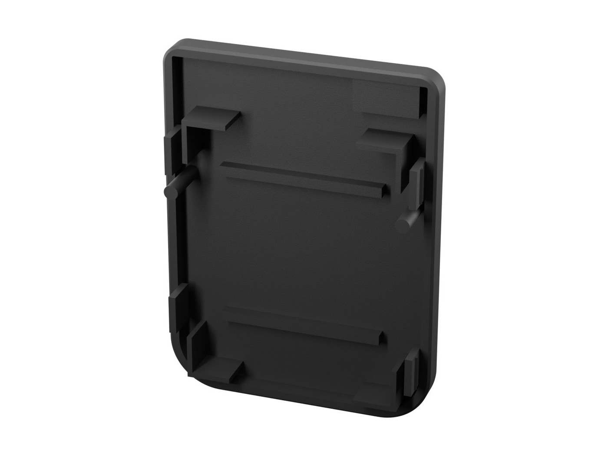
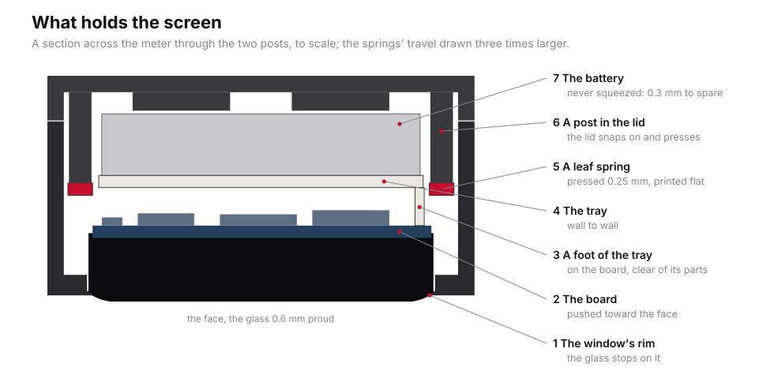
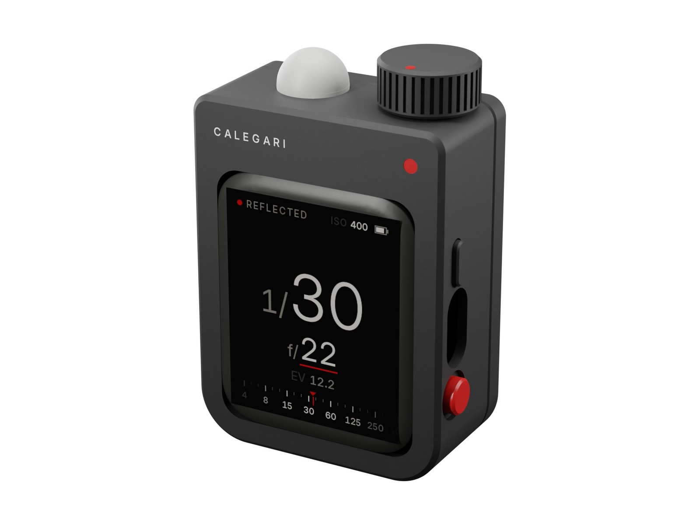

# Assembly

An hour, most of it soldering seven wires. Nothing is screwed or glued: the keys snap through the wall, the encoder threads into the top, the lid snaps on.

Flash the firmware (see [Firmware](firmware.md)) onto the Waveshare board before you start: it is easier to see that the board works while it is still loose on the bench.

## 1. Solder the wires to the sensor and the encoder

1. Cut seven wires of 30 AWG silicone wire, about 60 mm each. Strip 2 mm at each end and tin them. The Waveshare's header is fine: holes of 0.7 mm at a 1.27 mm pitch, so a thin wire and a fine tip.
2. **AS7341**: solder four wires into its holes from the top (the side with the chip): **VIN**, **GND**, **SCL**, **SDA**. The names are printed next to the holes. Cut the ends flush underneath: the board lies on ledges and must sit flat.
3. **Encoder**: cut its shaft to 8 mm above the body (above the threaded bushing, 8 mm from the body's top face), and file the burr. Bend its two switch pins flat against the body or cut them off: they are not used. On the three-pin side, solder a wire to each: **A** (one end), **C** (the middle), **B** (the other end). Which end is A only decides which way the dial turns, and the firmware can swap it.

## 2. The keys

From outside, push the **red key** into the round well on the right side, near the foot, until its two barbs click past the inside of the wall. Then the **power key**, the black pill, into its slot higher up. Each should spring back when pressed.

## 3. The screen

Lay the front shell face down on a soft cloth. Drop the Waveshare board in, glass first: the glass goes into the window and the board stops on the ribs, its USB-C in the side opening and its BOOT and power buttons behind the two keys. Press the keys: you should feel each button click through them.

## 4. The sensor and the dial

1. **Sensor**: the AS7341 lies across the top, chip up, towards the top wall. Slide its front edge into the groove in the face wall and let it drop onto its two ledges. Its chip sits under the port, its LED under the small window next to it.
2. **Encoder**: thread its bushing into the hole in the top wall from inside, turning the whole encoder, until its locating tab drops into the slot and it sits tight. The printed hole is a little small on purpose: the bushing's thread cuts its own. Do not use the nut.
3. **Wires**: lead the seven wires down to the header along the top edge of the Waveshare's back, cut each to length, and solder them into the header's holes as the drawing shows: VIN to **3V3**, the sensor's GND to the **GND** between VBUS and 3V3, SCL to **IO14**, SDA to **IO15**, A to **IO17**, B to **IO18**, and the encoder's C to the other **GND**, between 3V3 and TXD. Keep them flat against the board.

## 5. The tray and the battery

The tray is what holds the screen. Lay it over the back of the board, feet down, wall to wall: its feet stand on the board where it has no parts, its notch at the top clears the header's wires, and its opening on the left (seen from behind) is over the board's battery socket. Look for the two leaf springs cut in it near the sides: the lid's posts will press them.

**Check the battery's polarity** against the + and − marks at the board's BAT socket. Plug it in through the tray's opening, then lay the cell on the tray, its wires folded into the opening. The screen should light: press the power key if it does not.

## 6. Close it

Inside the lid: two posts, four fingers round the cell's corners, two ribs over it. Put the lid on, the back edge of the sensor into the lid's groove, and press it home at the four snaps until the seam closes all round. The posts meet the springs just before the snaps click: you feel a light push back. That push is what holds the screen against the window, whatever the tolerances of your print.

The cell is never squeezed: the fingers and the ribs leave it 0.3 mm all round, as a LiPo needs. To open the meter again, slip a fingernail or a plastic card into the seam at the foot and lift.

Press the **dial** onto the shaft, flat to flat, until it stops just clear of the top. Press the **dome** into its seat over the port: its three ribs hold it. When you do not need it, it goes in the same seat under the foot.

## 7. Check

1. Turn it on with the power key: CALEGARI, then the Light screen.
2. Turn the dial: the red-lined value changes. If it goes the wrong way, see [Firmware](firmware.md) (`CFG_ENC_REVERSE`).
3. Press the red key: the dot stops breathing and turns into a ring; the reading is held. Press again to let go.
4. Put the dome on and off: after a blink of the LED, the status line changes between REFLECTED and INCIDENT.
5. Then [calibrate](calibration.md).
