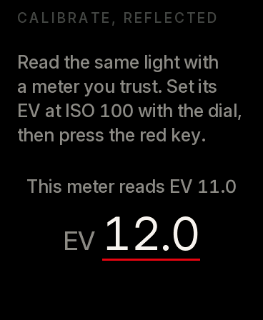
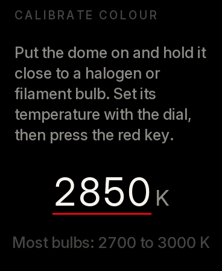

# Calibration

Three things, once, after the first assembly. The meter keeps them.

## 1. The dome's detection

The meter knows the dome is on because the sensor's LED, blinking under the dome's flange, sends some light back through it. How much depends on your print. Check it:

1. Connect the meter and open the monitor: `pio device monitor` in `firmware/`.
2. Take the dome off, point the meter at an ordinary room, and read the **probe** value it prints (the LED blinks every fifteen seconds, or when the light jumps).
3. Put the dome on and read it again.

The dome-off value should be near 0, the dome-on value clearly higher. `CFG_DOME_MIN` in `config.h` (0.40) must sit between them; if it does not, set it half way and load the firmware again. In very bright light the LED drowns and the meter keeps what it last knew. If the guess ever fails you, **Settings > Dome** sets it by hand.

## 2. Light

Reflected and incident are calibrated separately, each against a meter you trust (or, outdoors in clear midday sun, the sunny 16 rule: EV 15 at ISO 100).

1. **Settings > Calibrate light**. The screen says which one it is calibrating: with the dome off, reflected; with the dome on, incident.
2. Measure a large, evenly lit surface (a grey card, a wall) with your reference meter, set to ISO 100. For incident, measure the light with both meters' domes side by side.
3. Set that EV with the dial and point the Calegari Meter at the same thing. Under the heading it shows what it reads now.
4. Press the red key. The difference is stored, in tenths of a stop, up to 8 stops either way.
5. Put the dome on (or take it off) and do the other.

Settings shows both corrections (reflected first). Check once more in a different light, dim and bright: a good meter agrees within a third of a stop across the range.

## 3. Colour

The eight channels of the sensor, seen through your dome, each have their own gain. One reading under a light of known colour fixes them all.

1. Use a **halogen or clear filament bulb**, the only common light whose colour you can trust: 2700 to 3000 K, 2850 K for most. Not an LED "filament" bulb, not a frosted one if you can avoid it, and no daylight in the room.
2. **Settings > Calibrate colour**. Put the dome on and hold it 20 to 30 cm from the bulb, facing it.
3. Set the bulb's temperature with the dial (the box usually says it), and press the red key.

The Colour screen no longer says **Not calibrated**. Check it in daylight: overcast noon is about 6500 K, direct sun at midday about 5500 K.
