# Using the meter

## The controls

| | |
|---|---|
| **Dial** | changes the value with the red line under it. In the lists it moves; when a setting is open, it changes it |
| **Red key** | measures: holds the reading in Light and Colour, arms the flash, takes a reading in Zone. In the lists it chooses. In Zone, held for a second, it clears the readings |
| **Power key** | turns the meter on. Pressed: the modes and the settings; in the lists, back. Held for a second and a half: off |
| **The screen** | a swipe across changes mode; a tap does what the red key does |
| **The dome** | on: incident light, and colour. Off: reflected light through the port, 44 degrees across. It parks under the foot |

The red dot at the top left breathes while the meter reads and turns into a ring while it holds. Next to it, what the meter is measuring; on the right, the ISO and the battery.

The meter turns itself off after the time set in Settings (one minute unless you change it), dimming for the last ten seconds. Any control keeps it awake. It charges over its USB-C, on or off.

## Light

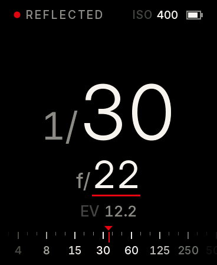 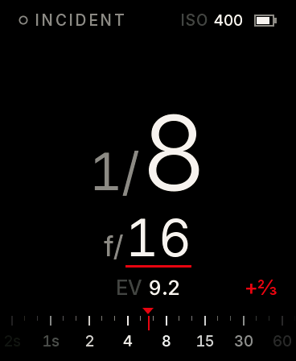 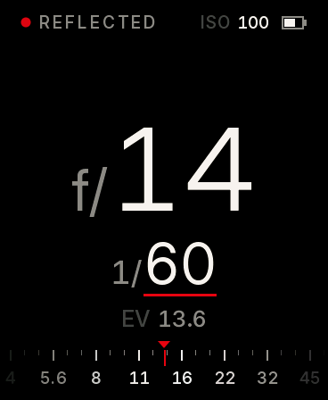

With the dome off the meter reads the light reflected from what it points at, and says **REFLECTED**. With the dome on it reads the light falling on it: hold it at the subject, dome towards the camera. It says **INCIDENT**, and you do not have to tell it: it sees the dome.

In **aperture priority** the dial sets the aperture, in thirds, from f/4 to f/64; the big number is the time. In **shutter priority** the dial sets the time and the big number is the aperture. Times are in whole stops, as a Copal shutter is marked, or in thirds (Settings > Shutter). Under the answer: the EV at your ISO, and the compensation when there is one. At the foot, the scale of the other value slides to the answer, the nearest marks brightest.

Press the red key to hold a reading, press again to let go.

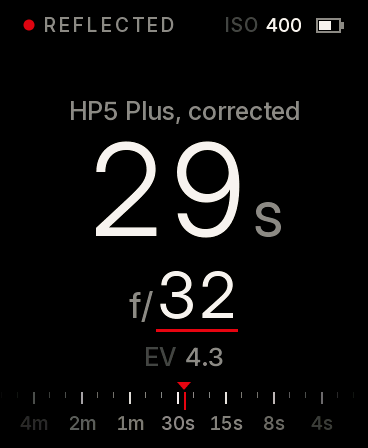 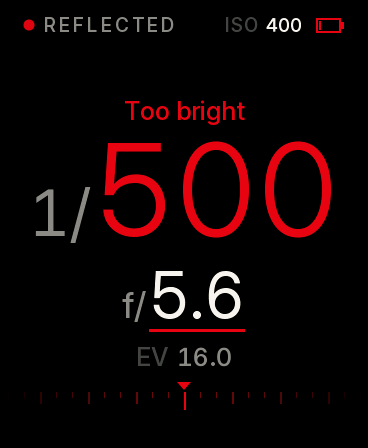

With a film chosen (Settings > Film), long exposures are corrected for reciprocity failure: the line over the answer says so, and the time is the one to give. When the answer is off the end of the shutter or the lens, it turns red and says **Too bright** or **Too dark**: close down, change ISO or add a filter.

## Flash

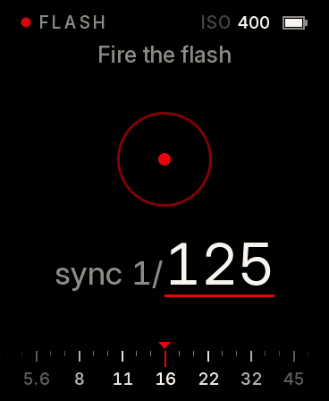 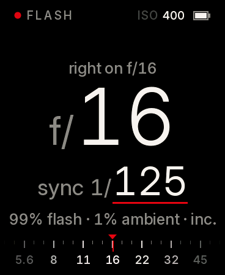

Choose **Flash**, set your sync speed with the dial (in whole stops, up to the fastest speed in Settings), and fire the flash with the test button or the camera. No cord: the meter watches for the burst. It answers with the aperture, and over it the tenths (**f/11 and 3 tenths**), under it how much of the exposure is flash and how much the ambient light during the sync time, and whether it read incident or reflected. For flash, incident with the dome is the usual way.

Every new burst replaces the reading; the red key clears it and waits again. If it says **Too bright**, the meter was saturated: fire again, it has turned its gain down.

## Colour

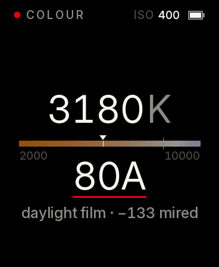 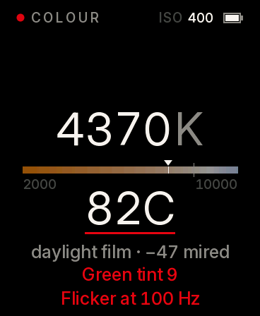

Put the dome on: the meter says so if you forget. It reads the colour temperature of the light in kelvin and marks it on a bar from 2000 to 10000 K (even in mired, so a filter moves the mark the same distance anywhere). The grey line is your film's balance; the dial changes it between **daylight** (5500 K) and **tungsten** (3200 K).

Under the bar, the **Wratten filter** that brings the light nearest to the film, and the shift in mired it needs. Then the **tint**: green or magenta, in thousandths of Duv, red from 6 up, when a colour-compensating filter (magenta for green light) is worth it. And **flicker at 100 or 120 Hz** when the light pulses with the mains, as fluorescent and many LED lights do: keep the shutter at 1/60 or slower under them.

The colour is only as good as its calibration: the screen says **Not calibrated** until you have done it once ([Calibration](calibration.md)).

## Zone

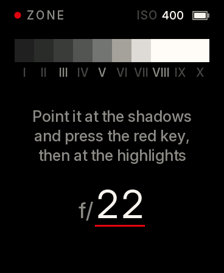 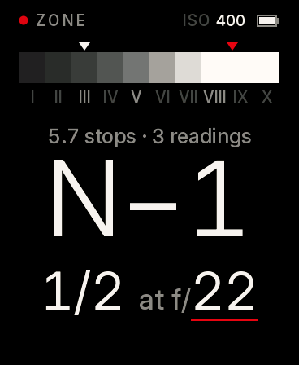

For black and white with the zone system. Take the dome off. Point the meter at the darkest shadow you want detail in and press the red key; then at the brightest highlight you want texture in, and press again. More readings refine the range.

The meter places the shadow on **Zone III** (white mark on the scale) and shows where the highlight falls (red mark). It gives the range in stops, the development that brings the highlight to Zone VIII (**N**, **N+1**, **N−1** and so on; red beyond two stops either way), and the exposure that puts the shadow on III, at the aperture you set with the dial. Hold the red key for a second to start again.

## Modes and settings

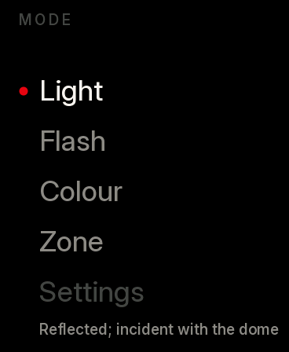 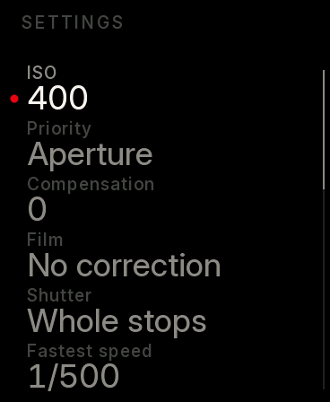 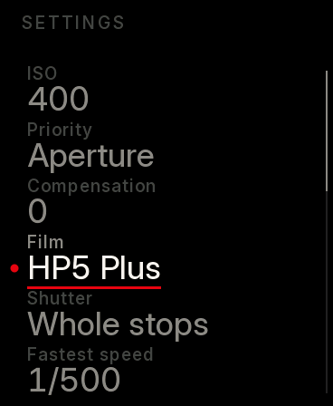

Press the power key for the list of modes, with **Settings** at the end. Turn to choose, press the red key (or tap) to open. In Settings, the red key opens a setting and the dial changes it; the red key again, or the power key, closes it. The power key goes back.

| Setting | Values | |
|---|---|---|
| ISO | 6 to 6400, in thirds | |
| Priority | aperture, shutter | which one the dial sets in Light |
| Compensation | −3 to +3, in thirds | added to every reading |
| Film | no correction, HP5 Plus, FP4 Plus, Delta 100, Delta 400, Pan F Plus, Tri-X 400, Acros II | reciprocity for long exposures |
| Shutter | whole stops, thirds | how times are given |
| Fastest speed | 1/500, 1/400, 1/250, 1/125 | your shutter's fastest; also the limit for the flash sync |
| Dome | automatic, always on, always off | if the automatic guess ever fails you |
| Film balance | daylight 5500 K, tungsten 3200 K | for Colour |
| Calibrate light | | the two corrections, reflected and incident, in tenths of a stop |
| Calibrate colour | | done or not yet |
| Sleep | 30 s, 1, 2, 5 min | |
| Brightness | automatic, 1 to 5 | automatic follows the light the sensor sees |
| Sound | on, off | a short tick for the red key and for a flash caught |
| Firmware | update | restarts into the USB download mode ([Firmware](firmware.md)) |
| Battery, Version | | to read |

Settings are kept when the meter is off.

## Care

The dome is the reference for incident light and colour: keep it clean, and if you print a new one, calibrate again. The port is a small hole: blow the dust out of it now and then. Do not leave the meter on a dashboard in the sun.
